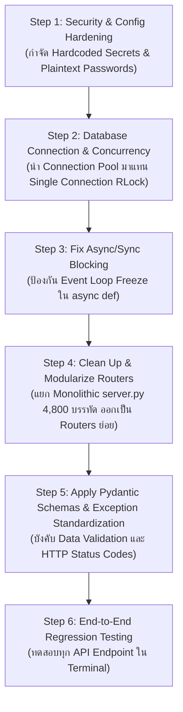

# 🗺️ แผนงาน Roadmap และขั้นตอนการดำเนินงาน: โครงการ Sawasdee Car (FastAPI + PostgreSQL)

**บทบาท:** [System Architect]  
**เอกสารอ้างอิง:** [audit_and_refactor_plan.md](file:///c:/Users/chati/OneDrive/Desktop/SawasdeeRental/audit_and_refactor_plan.md)  
**สถานะ:** รอการตรวจสอบและอนุมัติ (Pending Approval) ก่อนเริ่มลงมือแก้ไขโค้ดจริง

---

## 📌 บทนำและเป้าหมาย

เอกสารฉบับนี้จัดทำขึ้นโดยอ้างอิงจากโครงสร้างซอร์สโค้ดและฐานข้อมูลจริงของระบบ **Sawasdee Car** ปัจจุบัน (ตาราง `cars`, `bookings`, `customers`, `maintenance_records`, `work_order_logs`, `financial_records`, `insurance_records`, `users`) โดยแบ่งแผนงานออกเป็น **2 ระยะ (2 Phases)** ชัดเจน เพื่อให้ระบบมีความมั่นคง ปลอดภัย ปราศจากหนี้ทางเทคนิคเดิม ก่อนจะขยายสเกลฟีเจอร์ใหม่ได้อย่างยั่งยืน

---

# 🚀 Phase 1: แผนซ่อมแซมและจัดระเบียบระบบเดิม (Refactor & Bug Fix Plan)

เป้าหมายของ Phase 1 คือการเคลียร์จุดเสี่ยง [Critical], ปรับระเบียบ [Logic & Structure] และแก้ปัญหา Event Loop Blocking โดยแปลงระบบให้เป็น **FastAPI + PostgreSQL Stateless Architecture** อย่างแท้จริง

### ลำดับขั้นตอนการดำเนินการ (เรียงตามระดับความเสี่ยง):



---

### รายละเอียดการปฏิบัติงานแต่ละขั้นตอน:

#### 🔹 Step 1: Security & Config Hardening (ระดับความเสี่ยง: วิกฤตสูงสุด)
* **สิ่งที่ต้องทำ:**
  1. ลบ Hardcoded `DATABASE_URL` ที่ระบุรหัสผ่านจริงออกจาก `db.py` (บรรทัด 12) และ `database.py` (บรรทัด 5) บังคับให้อ่านค่าจากตัวแปรสภาพแวดล้อม (`.env`) เท่านั้น
  2. ลบ Hardcoded `LINE_DEFAULT_CHANNEL_ACCESS_TOKEN` และ `LINE_TARGET_USER_ID` ออกจาก `line_service.py`, `check_expiry_alert.py`, และ `test_line_api.py`
  3. ลบ Backdoor Hardcoded Password (`["admin", "admin123", "sawasdee2024", "sawasdee", "A248624"]` ฯลฯ) ออกจากฟังก์ชัน `login()` ใน `server.py`
  4. ติดตั้งระบบ Password Hashing (เช่น `passlib[bcrypt]` หรือ `hashlib` ร่วมกับ Salt) ตรวจสอบรหัสผ่านกับตาราง `users` ใน PostgreSQL โดยตรง
* **ไฟล์ที่ต้องแก้ไข:**
  - `db.py`
  - `database.py`
  - `line_service.py`
  - `check_expiry_alert.py`
  - `test_line_api.py`
  - `server.py` (หรือแยกไป `routers/auth.py`)
  - `.env` (ตรวจเช็กให้มี Key ครบถ้วน)
* **วิธีทดสอบหลังแก้:**
  - ทดสอบรัน Python script ตรวจหา Credentials ตกค้าง: `python -c "import db; print(db.DATABASE_URL)"`
  - ทดสอบ Login ด้วยรหัสผ่านเดิมที่เคย Hardcode ไว้ (ต้องไม่ผ่านหากไม่ตรงกับ Hash ใน DB)
  - ทดสอบ Login ด้วยบัญชีที่มีอยู่ในตาราง `users` ด้วยรหัสผ่านที่ถูกต้อง (ต้องผ่านและได้ HTTP 200)

---

#### 🔹 Step 2: ปรับปรุง Database Connection & Concurrency (ระดับความเสี่ยง: สูงมาก)
* **สิ่งที่ต้องทำ:**
  1. ปรับปรุง `pg_client.py` จากการใช้ Single Connection (`self._conn`) ร่วมกับ `threading.RLock()` ให้ใช้ **`psycopg_pool.ConnectionPool`** (หรือ SessionPool ของ SQLAlchemy) เพื่อรองรับ Concurrent Queries ขนานกันได้โดยไม่ติด Lock
  2. ยกเลิกการรัน DDL Migrations อัตโนมัติในทุกๆ Request แรกที่เชื่อมต่อ ให้แยก Migration ออกมารันใน Startup Lifecycle เพียงครั้งเดียว
  3. ปรับสถาปัตยกรรมจาก In-Memory DataStore (`store` + JSON files) ให้เป็นการ Query ตรงจาก PostgreSQL ในจุดที่จำเป็น และบันทึกข้อมูลแบบ Transactional โดยตรง
* **ไฟล์ที่ต้องแก้ไข:**
  - `pg_client.py`
  - `db.py`
  - `database.py`
* **วิธีทดสอบหลังแก้:**
  - ทดสอบยิง Request พร้อมกันแบบ Concurrency (เช่น ยิง `GET /api/cars` และ `GET /api/bookings` พร้อมกันหลายๆ เธรด) ยืนยันว่าไม่มี Deadlock และ Connection ไม่หลุด

---

#### 🔹 Step 3: แก้ไขปัญหา Async/Sync Conflict (Event Loop Freeze) (ระดับความเสี่ยง: สูงมาก)
* **สิ่งที่ต้องทำ:**
  1. แก้ไข Route Handler ใน `server.py` ที่เป็น `async def` แต่มีการเรียกฟังก์ชัน Synchronous หนักๆ:
     - จุดที่มีการสร้าง PDF ผ่าน ReportLab (`pdf_engine.py`) ให้รันผ่าน `anyio.to_thread.run_sync(...)` หรือประกาศ Handler เป็น `def` ธรรมดา เพื่อให้ FastAPI ส่งงานเข้า External Threadpool
     - จุดที่มีการเรียก `requests.post()` ของ LINE API ให้ใช้ `httpx.AsyncClient` แทน หรือหุ้มด้วย Worker Thread
     - จุดที่มีการอ่าน/เขียนไฟล์รูปภาพหรือ JSON ใน Disk
* **ไฟล์ที่ต้องแก้ไข:**
  - `server.py`
  - `line_service.py`
  - `pdf_engine.py`
  - `routers/cars.py`
* **วิธีทดสอบหลังแก้:**
  - ทดสอบเรียก Route สร้าง PDF `/api/pdf/contract/{bk_id}` พร้อมกับเปิดหน้าเว็บหน้าอื่น ยืนยันว่าหน้าเว็บอื่นไม่ติดค้าง (Non-blocking response)

---

#### 🔹 Step 4: แตก Modular Routers & จัดระเบียบ Entry Point (ระดับความเสี่ยง: ปานกลาง)
* **สิ่งที่ต้องทำ:**
  1. ตั้ง `main.py` เป็น Root Entry Point หลักเพียงจุดเดียว อัปเดต `Procfile` และ `render.yaml` ให้รัน `uvicorn main:app`
  2. ยุบ/ลบไฟล์สตาร์ตและ Service ซ้ำซ้อน:
     - ยุบ `gdrive_service.py` และ `google_drive_service.py` เข้ากับ `services/google_drive_service.py`
     - ยุบสคริปต์ Root `import_cars.py`, `import_cars_excel.py` เข้ากับ `scripts/`
     - นำเข้า `lifespan` handler มาแทน `@app.on_event("startup")`
  3. แยกย่อย `server.py` (4,800 บรรทัด) ออกเป็น Routers ย่อยภายใต้โฟลเดอร์ `routers/`:
     - `routers/auth.py`: ระบบ Authentication & User Management
     - `routers/cars.py`: จัดการข้อมูลรถยนต์, สเปก, รูปถ่าย 4 มุม
     - `routers/bookings.py`: การจอง, คำนวณวันเช่า, ส่งมอบ-รับคืนรถ
     - `routers/customers.py`: จัดการข้อมูลลูกค้า
     - `routers/maintenance.py`: แจ้งซ่อม, บันทึกค่าใช้จ่าย, Work Orders
     - `routers/finance.py`: รายรับ-รายจ่าย, การเงิน
     - `routers/reports.py`: Dashboard, KPIs, รายงานผลประกอบการ
     - `routers/pdf.py`: สัญญาเช่า, ใบเสร็จ, ใบตรวจสภาพรถ
     - `routers/line.py`: LINE Webhook & Push Notifications
* **ไฟล์ที่ต้องสร้าง/แก้ไข:**
  - สร้างไฟล์ใน `routers/*.py`
  - แก้ไข `main.py` ให้ include routers ทั้งหมด
  - อัปเดต `Procfile` และ `render.yaml`
  - ทำความสะอาดไฟล์ `server.py`, `app.py`, `start_web.py`
* **วิธีทดสอบหลังแก้:**
  - รัน `uvicorn main:app --reload` และเรียกดู OpenAPI Documentation ที่ `http://localhost:8000/docs` ตรวจสอบว่าทุก Router และ Endpoint ปรากฏครบถ้วน ไม่มี Path ชนกัน

---

#### 🔹 Step 5: Data Validation (Pydantic) & Exception Standardization (ระดับความเสี่ยง: ปานกลาง)
* **สิ่งที่ต้องทำ:**
  1. ปรับ Route Payloads จาก `payload: Dict[str, Any]` ให้ใช้ Pydantic Schemas จาก `schemas.py` เช่น `VehicleCreate`, `VehicleUpdate`, `CustomerBase`, `BookingCreate`
  2. ปรับการส่ง Error จากเดิมที่ return `{"success": False, "error": ...}` (HTTP 200) ให้ใช้ `raise HTTPException(status_code=..., detail=...)`
  3. กำจัด `except Exception: pass` โดยใส่ Logging บันทึก Stack Trace ที่แท้จริง
* **ไฟล์ที่ต้องแก้ไข:**
  - ทุกไฟล์ใน `routers/*.py`
  - `schemas.py`
* **วิธีทดสอบหลังแก้:**
  - ยิง Payload ที่ข้อมูลไม่ครบหรือชนิดข้อมูลผิด (เช่น `daily_rate = "abc"`) ระบบต้องตอบกลับด้วย HTTP 422 Unprocessable Entity พร้อมระบุ Field ที่ผิดพลาดอย่างถูกต้อง

---

#### 🔹 Step 6: End-to-End Regression Testing (ทดสอบรอบสุดท้าย)
* **วิธีทดสอบ:**
  - รันคำสั่งทดสอบครบวงจรใน Terminal:
    1. ตรวจสอบ Syntax & Type Error: `python -m py_compile main.py`
    2. รันเซิร์ฟเวอร์: `uvicorn main:app --port 8000`
    3. ยิง Smoke Test ผ่านคำสั่ง `curl` หรือสคริปต์ Python ทดสอบฟังก์ชันหลัก:
       - Login / Register
       - ดึงรายการรถยนต์ (`GET /api/cars`)
       - สร้างการจองรถ (`POST /api/bookings`)
       - ออกเอกสารสัญญา PDF (`GET /api/pdf/contract/...`)
       - บันทึกการส่งมอบรถและอัปโหลดรูปภาพ

---

# 🌟 Phase 2: แผนพัฒนาฟีเจอร์ต่อยอด (Feature Expansion Roadmap)

จากการวิเคราะห์โครงสร้างฐานข้อมูลที่มีอยู่ในปัจจุบัน (`schema.sql` และ `models.py`) พบว่าระบบ Sawasdee Car มีโครงสร้างตารางที่ครอบคลุมงานรถเช่าเบื้องต้นไว้เป็นอย่างดี แต่ยังขาดโมดูลระดับสูงสำหรับการขยายสเกลฟีเจอร์ในอนาคต

---

### 1. วิเคราะห์ความพร้อมของข้อมูลปัจจุบัน vs สิ่งที่ต้องต่อยอด (Gap Analysis)

| หมวดหมู่ฟีเจอร์ | ข้อมูลที่มีอยู่ในฐานข้อมูลปัจจุบัน | สิ่งที่ต้องพัฒนาเพิ่มทางสถาปัตยกรรม & โครงสร้าง |
| :--- | :--- | :--- |
| **1. ระบบแจ้งเตือนภาษี / พ.ร.บ. / ประกันภัย / ซ่อมบำรุงอัตโนมัติ** | มีคอลัมน์ใน `cars`: `tax_expire_date`, `prb_expire_date`, `insurance_expire_date`, `last_service_date`, `next_service_mileage`, และตาราง `insurance_records` | **ขาด:** Cron Scheduler ที่ทำงานแบบ Native Background Service ที่เชื่อถือได้ (ปัจจุบันมีเพียงสคริปต์ `check_expiry_alert.py` ที่ต้องรันมือ หรือเธรดวนลูป `while True: sleep(120)`)<br>**ควรเพิ่ม:** ตาราง `notification_logs` เพื่อบันทึกประวัติว่าแจ้งเตือนคันไหนไปแล้วบ้าง ป้องกันการส่งซ้ำทุกวัน |
| **2. ระบบจัดการเอกสารสัญญาและใบตรวจสภาพรถ PDF (Digital Contract & E-Signature)** | มีคอลัมน์ใน `bookings`: `contract_pdf_url`, `checkout_pdf_url`, `checkin_pdf_url`, รูปถ่ายตรวจสภาพ 4 มุม (`checkin_img_*`) และฟังก์ชันใน `pdf_engine.py` | **ขาด:** ระบบ Digital Signature Pad บันทึกลายเซ็นลูกค้าฝั่ง Frontend ลง PDF, ระบบ QR Code ยืนยันความถูกต้องของสัญญา, และการเก็บ Document Versioning (เมื่อมีการต่อสัญญา / Extension) |
| **3. ระบบเชื่อมต่ออุปกรณ์ IOT (GPS Telematics, Easy Pass & Smart Fuel)** | มีคอลัมน์ `mileage`, `dispatch_mileage`, `return_mileage`, `dispatch_fuel`, `return_fuel` ในตาราง `bookings` และ `cars` | **ขาด:** ตาราง `telematics_logs` สำหรับรับค่าพิกัด GPS ละติจูด/ลองจิจูด, ความเร็ว, และระดับน้ำมันแบบเรียลไทม์จาก Box GPS ของรถเช่า<br>**ขาด:** ตาราง `toll_expenses` (Easy Pass / M-Flow) สำหรับดึงค่าผ่านทางมาคิดเงินลูกค้าตอนคืนรถอัตโนมัติ |
| **4. ระบบ LINE Official Account (LINE OA) แบบโต้ตอบอัตโนมัติ** | มีฟังก์ชันพื้นฐานใน `line_service.py` (Push & Broadcast) และตาราง `users`/`customers` มี `line_user_id` | **ขาด:** Webhook Event Handling แบบสมบูรณ์ (โต้ตอบ Postback / Message Event, Rich Menu เชื่อมโยงบัญชีลูกค้า/พนักงาน, แจ้งสถานะคิวรถ, ส่งพิกัดส่งมอบรถให้คนขับ) |

---

### 2. แนวทางการออกแบบสถาปัตยกรรมเพื่อรองรับ Phase 2 (Clean Architecture Pattern)

เพื่อให้ฟีเจอร์ใหม่ใน Phase 2 พัฒนาได้อย่างรวดเร็ว โดยไม่ทำให้โค้ดกลับไปเละหรือไฟล์บวมอีกรอบ เราจะนำสถาปัตยกรรมแบบ **Layered Architecture** มาใช้:

```
SawasdeeRental/
├── main.py                  # FastAPI Application Lifecycle & Router Inclusion
├── core/                    # การตั้งค่าแกนกลางของระบบ
│   ├── config.py            # Pydantic BaseSettings (อ่าน .env แบบ Type-safe)
│   ├── database.py          # PostgreSQL Connection Pool & Async Engine
│   └── security.py          # Password Hashing & JWT Authentication Guard
├── models/                  # SQLAlchemy ORM Models (ตรงกับ Database Schema)
│   ├── car.py
│   ├── booking.py
│   ├── customer.py
│   ├── maintenance.py
│   └── telematics.py        # [Phase 2] รองรับ GPS / Easy Pass
├── schemas/                 # Pydantic Request & Response Schemas
├── routers/                 # Controller Endpoints (เฉพาะ HTTP Request / Response)
├── services/                # Business Logic Layer (คำนวณราคา, ออกสัญญา, คุม State)
│   ├── booking_service.py   # จัดการ Logic คิวรถ, Overlap Guard, คำนวณวัน
│   ├── pdf_service.py       # จัดการสร้าง PDF สัญญาและใบตรวจสภาพ
│   ├── notification_service.py # รวมศูนย์การส่ง LINE / Email / SMS
│   ├── telematics_service.py # [Phase 2] ดึงข้อมูล GPS / M-Flow
│   └── gdrive_service.py    # จัดการอัปโหลดไฟล์ Google Drive
└── tasks/                   # Scheduled & Background Jobs
    ├── expiry_checker.py    # ตรวจสอบวันหมดอายุภาษี/ประกัน ทุกเที่ยงคืน
    └── sync_tasks.py        # แบ็กกราวด์ประมวลผลงานหนัก
```

---

### 3. ฟีเจอร์เรือธงที่จะพัฒนาใน Phase 2 (Target Features)

#### 🎯 Feature A: Automated Smart Alerts (ระบบเตือนอัจฉริยะ)
* **กลไก:** ใช้ `APScheduler` หรือระบบ Scheduled Tasks ของ FastAPI ทำงานทุกวันเวลา 08:00 น.
* **เงื่อนไข:**
  - รถที่ภาษี / พ.ร.บ. / ประกันภัย จะหมดอายุในอีก **30 วัน, 15 วัน, 7 วัน, และ 1 วัน**
  - รถที่มีกำหนดเปลี่ยนถ่ายน้ำมันเครื่องในอีก **1,000 กิโลเมตร** หรือตามรอบวัน
* **การส่งข้อความ:** ยิง Flex Message ผ่าน LINE OA หาฝ่ายดูแลยานพาหนะและแอดมิน พร้อมปุ่มกด "เปิดใบงานซ่อมบำรุงทันที"

#### 🎯 Feature B: E-Contract & Digital Check-in/Check-out (สัญญาและใบตรวจสภาพไร้กระดาษ)
* **กลไก:**
  - สร้างหน้า Web App สำหรับให้พนักงานและลูกค้าตรวจสภาพรถรอบคันพร้อมกันบนมือถือ/แท็บเล็ต
  - ลูกค้าลงลายมือชื่อดิจิทัล (Digital Signature Canvas) บนหน้าจอ
  - ผนวกลายเซ็นลงใน PDF Contract และ Inspection Sheet อัตโนมัติ แล้วอัปโหลดเข้า Google Drive พร้อมส่งลิงก์เข้า LINE ลูกค้าทันที

#### 🎯 Feature C: GPS Telematics & Easy Pass / M-Flow Integration
* **กลไก:**
  - สร้าง Webhook Receiver Endpoint (`POST /api/telematics/ping`) เพื่อรับข้อมูลตำแหน่ง, เลขไมล์ปัจจุบัน, และปริมาณน้ำมัน
  - อัปเดตเลขไมล์รถในระบบอัตโนมัติโดยที่พนักงานไม่ต้องเดินไปจด
  - ตรวจสอบประวัติการผ่านด่าน Easy Pass / M-Flow ในช่วงเวลาการเช่าเพื่อนำยอดค่าผ่านทางมารวมในบิลคิดเงินตอนคืนรถ

#### 🎯 Feature D: LINE OA Customer Self-Service & Staff Work Order Flow
* **กลไก:**
  - **สำหรับลูกค้า:** เมนู LINE เช็กสถานะการจอง, ดูสัญญาเช่า PDF, และแจ้งขอต่อเวลาเช่ารถ (Extend Booking)
  - **สำหรับพนักงานส่งรถ (Staff):** เมนู "งานของฉันวันนี้" แจ้งเตือนงานส่งรถ/รับรถคืน พร้อมแผนที่นำทางไปยังจุดส่งมอบรถ

---

## 📋 สรุปข้อเสนอแนะและขั้นตอนถัดไป

1. **ลำดับการลงมือทำ:**
   - **ก้าวแรก:** ดำเนินการ **Phase 1** ให้เสร็จสิ้นสมบูรณ์ก่อน (แก้จุดวิกฤตความปลอดภัย, แก้ปัญหา Event Loop Blocking, แตก Routers และทดสอบ API ทั้งหมดให้เสถียร 100%)
   - **ก้าวสอง:** เมื่อ Phase 1 ผ่านการทดสอบและทำงานได้อย่างเสถียรบน Terminal แล้ว จึงเริ่มต่อยอด **Phase 2** ตามแนวทาง Clean Service Layer ที่วางแผนไว้
2. **การขออนุมัติ:**
   - กรุณาตรวจสอบแผนงานทั้ง 2 ระยะในเอกสารนี้ หากเห็นชอบและอนุมัติ สามารถแจ้งยืนยันเพื่อให้ **[Backend Developer]** เริ่มต้นงานตามขั้นตอนของ **Phase 1 (Step 1)** ได้ทันทีครับ
